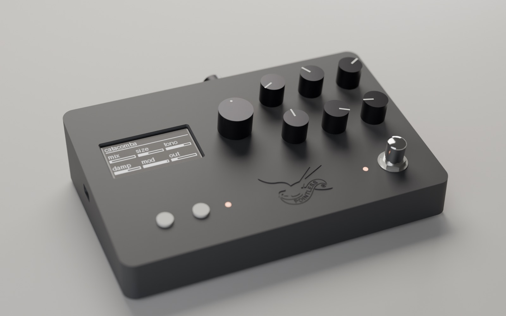
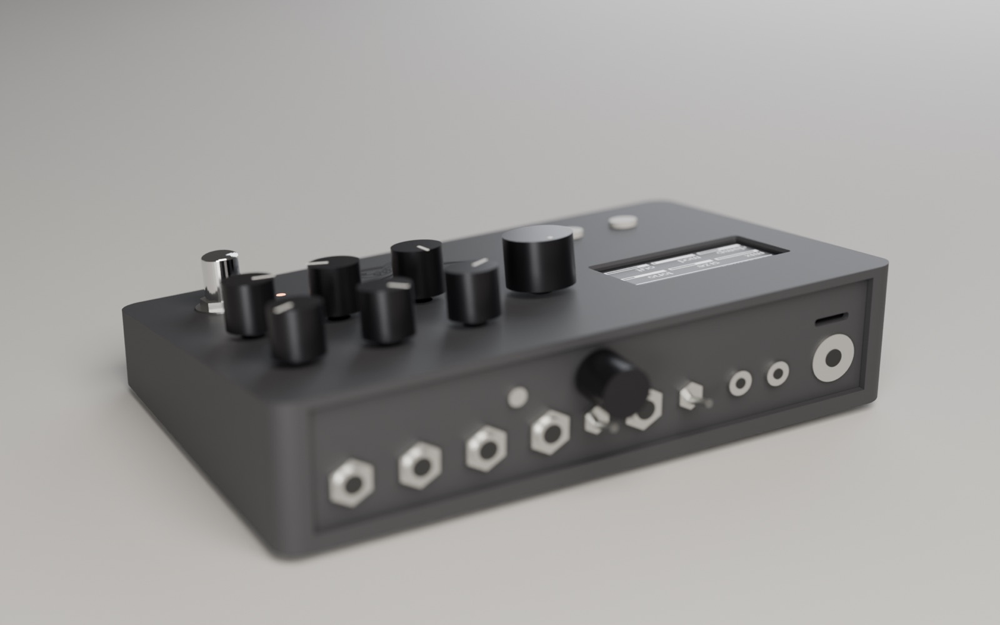
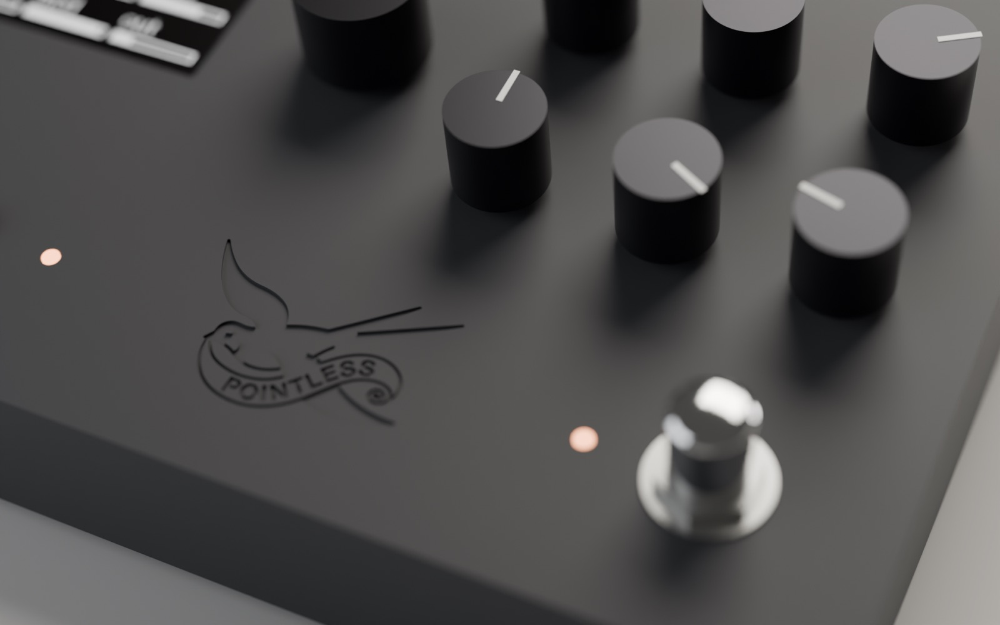

# PA-TELAIO

*[Versione italiana](README.md)*

A desktop instrument for prototyping audio effects on the Electro-Smith [Daisy Seed3](https://electro-smith.com/).
One piece of hardware, many effects: you change the firmware, not the box. Inspired by norns and the Torso S-4.
A Pointless Audio project, running alongside its plugins.

- stereo 1/4" in and out, instrument (1 MΩ) or line level (INST/LINE switch, −12 dB);
- input and output stages with two TLC2272 op-amps, on stripboard;
- discrete JFET input preamp (J201, two stages per channel) on a separate small board, switchable (PRE) with
  GAIN on the rear: simulated in ngspice, `hardware/preamp/`;
- 6 pots, a push encoder, 2 keys, a jack for an external dual footswitch;
- 2.42" 128×64 OLED;
- TRS type A MIDI in and out, microSD (on a separate I/O board);
- stereo true bypass with a 3PDT footswitch, plus DSP bypass for trails;
- enclosure: a parametric 3D-printed case or a 1590DD aluminium box.



| Rear: jacks, MIDI, DC, preamp GAIN and PRE, microSD | Detail |
|---|---|
|  |  |

*Renders of the model (`case/case.py`, 29 Oct 2026), not photos: the case has not been printed yet.*

## Status

**Nothing has been bought, built or printed yet.** The circuit is designed and checked by script, not tested on
the bench. The case is modelled and checked; a first test print failed (a printer issue, not a model issue). The
test firmware is written; the current version has not been compiled yet.

Detailed status, open decisions and open issues: [`docs/stato.md`](docs/stato.md).

## Layout

| Folder | Contents |
|---|---|
| `hardware/` | circuit and stripboard: `layout.py` (source of truth: parts, track cuts, jumpers, expected netlist), assembly page `prototipo-veroboard-seed3.html`, parts list and carts `ordine_componenti.md`, stripboard vs PCB comparison `strade_circuito.md` |
| `case/` | parametric printed case `case.py` (build123d) with mutation tests `test_case.py`, layer-by-layer printability check, 1590DD box `scatola.py`; one page per option: `stampa_chiron.md` (home printing), `servizio_stampa.md` (print service), `scatola_1590DD.md` |
| `firmware/collaudo/` | test firmware: passthrough, bypass, mono, pots, encoder, OLED, MIDI, DFU from the keys |
| `docs/` | `progetto.md` (decisions and rationale, pin map, case, assembly, firmware, bench checks), `stato.md`; `storico/` holds superseded documents with known errors (see `progetto.md`) |

All documentation is in Italian.

## Checking the circuit

Plain Python 3, no dependencies.

```bash
cd hardware
python3 layout.py        # must print "OK ... nessun corto, nessun aperto" (no shorts, no opens)
python3 test_layout.py   # mutation tests: every line must say RILEVATO (detected)
python3 page.py          # regenerates prototipo-veroboard-seed3.html
```

Conventions: `x` = hole along the strip (0..29), `y` = strip (0..44), horizontal strips; the HTML page numbers rows
and holes from 1. The script checks connections, not mechanics: part pitch and wire routing are checked by hand.

## Regenerating the case

You need [uv](https://docs.astral.sh/uv/): each script declares its dependencies in its header (build123d 0.13,
Python 3.12), no manual venv. Outputs are not in the repository and are regenerated:

```bash
cd case
uv run case.py            # builds, checks, exports to out/: "OK ... nessuna collisione" (no collisions)
uv run test_case.py       # 35 mutations, every line RILEVATO (takes a few minutes)
uv run stampabilita.py    # layer-by-layer printability, no supports
uv run scatola.py         # 1590DD box: model, drilling template and coordinates
uv run piatto_unico.py    # all parts on a single build plate
uv run render/esporta.py && blender -b -P render/scena_blender.py -- YYYY-MM-DD   # renders into render/YYYY-MM-DD/
```

- `case/out/`: STL files already oriented for printing, STEP, `assieme.step` and `assieme.glb`; `out/servizio/` is
  the variant for powder-bed print services (MJF/SLS);
- `case/stampa/`: G-code. Slicing uses an external script that is not included (see `case/stampa_chiron.md`);
- `case/render/`: PNG.

The check reads `hardware/layout.py`, turns every stripboard part into a keep-out volume, then checks collisions,
USB-C alignment, panel thickness for the bushings, clearance between knobs, logo engraving and the OLED window.
The dimensions of bought parts live in the dictionaries at the top of `case.py`: the model is drawn on the initial
parts and must be re-aligned to the parts actually bought before printing the panels (details in
`docs/progetto.md`).

## Building the test firmware

You need the ARM toolchain (`arm-none-eabi-gcc`, tested with 13.2.1; install it with the
[Daisy Toolchain](https://github.com/electro-smith/DaisyToolchain)). Clone libDaisy into `firmware/libDaisy`
(commit `facb66c` or later, for Seed3 support):

```bash
cd firmware
git clone --recurse-submodules https://github.com/electro-smith/libDaisy.git
cd libDaisy && make -j && cd ..
cd collaudo && make
make program-dfu
```

To enter DFU with the case closed, hold K1 and K2 at power-up; with the case open, BOOT + RESET on the Seed. The test
firmware exercises passthrough, bypass (K1), mono (K2), pots and encoder on screen, MIDI in and out, input peaks and
board version. Pin map and bench checks: `docs/progetto.md`.

## License

- hardware (circuit, case, box, documentation): [CERN-OHL-S-2.0](LICENSES/CERN-OHL-S-2.0.txt);
- firmware and support scripts: [MIT](LICENSES/MIT.txt);
- the Pointless Audio name and logo are excluded from both: anyone distributing or manufacturing the case removes
  or replaces the logo (`LOGO_SVG` in `case/case.py`).

Which file is under which license: [`LICENSE`](LICENSE).
