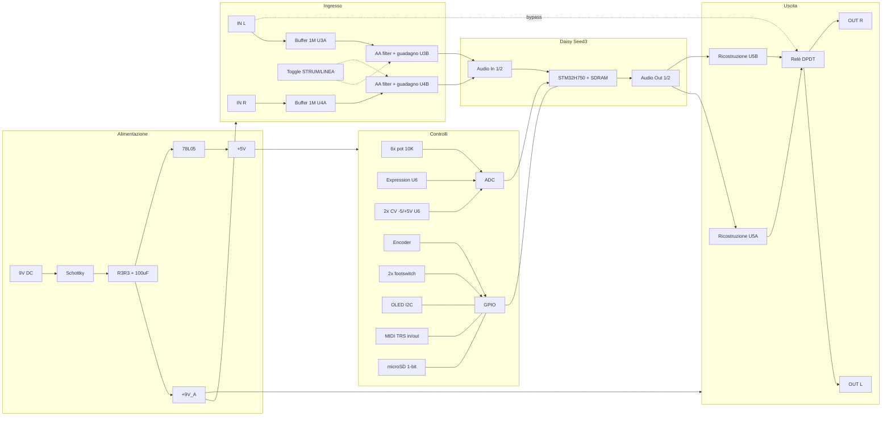

> **ATTENZIONE — documento superato, contiene un errore.** Nello stadio d'ingresso (sezione 5)
> R12/R13 da 4K7 con C18/C19 da 33 nF verso massa formano un passa-basso a circa 1 kHz:
> taglierebbe metà dello spettro della chitarra. Probabile trascrizione errata della Fig. 3.4
> del datasheet Seed3. Lo stesso errore è nella BOM `PA-TELAIO_BOM.xlsx`. Non costruire da qui.
> Il riferimento attuale è `hardware/layout.py` e la pagina HTML generata.

# PA-TELAIO — piattaforma pedale Daisy Seed3

Telaio neutro per prototipare effetti diversi sullo stesso hardware.
Schematica stadio per stadio, riferimenti allineati alla BOM.

**Fonte dei circuiti di riferimento:** Daisy Seed3 Datasheet v2.1.0 (Qu-Bit Electronix / Daisy),
figure 1.1, 3.1, 3.4, 3.5, 4.1, 4.4, 4.5, 5.1, 7.1, 7.5.
Dove ho scelto io un valore non presente nel datasheet, è indicato esplicitamente come
`[scelta di progetto]` e va verificato a banco.

---

## 1. Decisioni di progetto bloccate

| Voce | Scelta | Perché |
|---|---|---|
| Livello I/O | Strumento (1 MΩ) + guadagno commutabile x1 / ~x5 | copre chitarra e livello linea senza due front-end |
| Alimentazione | 9 V DC center-negative, single supply, bias a metà rail | standard pedale, compatibile con daisy-chain |
| Canali | Stereo in / stereo out, R normalizzato su L | permette effetti stereo e dual-input (idea "Ombra") |
| Bypass | Relè latching DPDT pilotato da firmware | true bypass / buffered / con coda decisi in software |
| Controlli | 6 pot su ADC diretti, senza multiplexer | 12 ADC disponibili, lettura più veloce, meno componenti |
| Serigrafia pot | Nessuna | i nomi li scrive l'OLED, è ciò che rende il telaio riusabile |
| SD | SDMMC 1-bit | libera 3 GPIO, velocità sufficiente per IR e preset |

---

## 2. Diagramma a blocchi



---

## 3. Alimentazione (datasheet Fig. 1.1)

```
J1 (tip = GND, sleeve = +9V, center-negative)
  sleeve --> D1 (NSR1020MW2T3G, anodo verso jack) --> nodo +9V
  tip    --> GND

+9V  --- C1 100uF --- GND
+9V  --- C5 100nF --- GND
+9V  --- R1 3R3 ---> +9V_A
+9V_A --- C2 100uF --- GND
+9V_A --- C6 100nF --- GND

+9V  --- R2 3R3 ---> DSY_VIN (pin 39 Seed3)
DSY_VIN --- C3 100uF --- GND
DSY_VIN --- C4 100uF --- GND

+9V --> U1 (78L05) IN
U1 IN  --- C7 10uF --- GND
U1 OUT --- C8 100nF --- GND  ==> +5V
```

**Masse:** AGND (pin 20) e DGND (pin 40) collegati in un unico punto sul PCB, vicino al
connettore di alimentazione. Piano di massa analogico e digitale separati, uniti solo lì.
Il datasheet è esplicito: AGND deve essere collegato a DGND.

**Nota:** i regolatori del Seed3 scaldano di più con VIN alta. A 9 V è entro spec (4–17 V),
ma va misurata la temperatura a pieno carico DSP.

---

## 4. Riferimento di bias (datasheet Fig. 3.1)

```
+9V_A --- R3 10K --- nodo AREF_DIV --- R4 10K --- GND
AREF_DIV --- C9 10uF  --- GND
AREF_DIV --- C10 100nF --- GND
AREF_DIV --- C11 100uF --- GND
AREF_DIV --> U2A (+)  [MCP6002, alimentato da +9V_A]
U2A (-) <--> U2A out  (buffer unity)
U2A out --> AREF_AUDIO_BIAS
AREF_AUDIO_BIAS --- R5 10K --- GND   (carico minimo permanente)
```

La seconda metà di U2 resta libera: portala su un header di espansione.

---

## 5. Ingresso livello strumento — per canale, x2 (datasheet Fig. 3.4)

Rif. canale L: U3A/U3B. Canale R: U4A/U4B, componenti gemelli.

```
J2 tip --- R8 100R --- nodo IN_A
IN_A --- C12 100pF --- GND        (filtro RF)
IN_A --- R6 1M --- GND            (impedenza ingresso 1M)
IN_A --- C14 10uF --> U3A (+)
U3A (+) --- AREF_AUDIO_BIAS tramite R? vedi nota
U3A (-) <--> U3A out              (buffer unity, OPA1652 su +9V)

U3A out --- R10 3K3 --- nodo F1
F1 --- C16 1nF --- GND            (LP ~48 kHz)
F1 --- R12 4K7 --- nodo F2
F2 --- C18 33nF --- GND
F2 --> U3B (+)

U3B (-) --- R14 10K --- U3B out
U3B (-) --- C20 330pF --- U3B out
U3B (-) --- R20 8K2 --- SW1 --- AREF_AUDIO_BIAS   [scelta di progetto]
U3B out --- R18 33K --- U3B (-)                   [scelta di progetto]

U3B out --- R16 100R --- C22 10uF --> Seed3 pin 16 (Audio In 1)
```

**Guadagno commutabile.** SW1 aperto: R20 scollegato, lo stadio è a guadagno unitario
(linea). SW1 chiuso: guadagno `1 + R18/R20 ≈ 5` (chitarra). Un solo DPDT commuta entrambi
i canali. I valori 33K/8K2 sono una mia scelta: vanno tarati a banco misurando il fondo
scala reale del codec, che accetta 3.6 Vpp (circa 1 Vrms) sugli ingressi audio.

**Normalling.** J3 (IN R) è un jack switched: senza jack inserito, il normal riporta il
segnale di IN L anche sul canale destro (datasheet Fig. 3.8).

**Attenzione:** gli ingressi audio del Seed3 sono accoppiati in AC e hanno limite assoluto
±1.8 V. Il clamp non c'è: se metti guadagno oltre x5, aggiungi due diodi Schottky verso
i rail di clamp prima di C22.

---

## 6. Uscita livello strumento — per canale, x2 (datasheet Fig. 3.5)

```
Seed3 pin 18 (Audio Out 1) --- C26 10uF --- R22 15K --> U5A (-)
U5A (-) --- R24 33K --- U5A out
U5A (-) --- C24 100pF --- U5A out
U5A (+) --- AREF_AUDIO_BIAS
U5A out --- R28 100R --- C28 10uF --- nodo OUT_L
OUT_L --- R26 10K --- GND        (scarica, niente pop)
OUT_L --> K1 (contatto NO)
```

U5 = OPA1652 dual, un op-amp per canale, alimentato da +9V.

---

## 7. Bypass a relè

```
K1 = relè DPDT latching 5V, due bobine (set / reset)

Seed3 D26 --- R30 10K --- Q1 base (MMBT3904)
Q1 collettore --- bobina SET --- +5V
bobina SET // D2 (1N4148, catodo su +5V)

Seed3 D27 --- R31 10K --- Q2 base (MMBT3904)
Q2 collettore --- bobina RESET --- +5V
bobina RESET // D3 (1N4148, catodo su +5V)

Contatti K1:
  poli   = J4 tip (OUT L), J5 tip (OUT R)
  NO     = U5A out / U5B out   (effetto attivo)
  NC     = J2 tip / J3 tip     (true bypass)
```

Latching: nessun consumo a regime, e lo stato sopravvive allo spegnimento.
Il firmware decide se pilotare i contatti (true bypass) o lasciarli fissi sull'effetto
e fare il bypass in DSP (buffered, con coda). Impulso di set/reset tipico 10–20 ms:
verificare sul datasheet del relè scelto.

---

## 8. Controlli analogici

**Potenziometri (datasheet Fig. 4.1), x6**

```
RVn pin1 --- GND
RVn pin3 --- +3V3A (Seed3 pin 21)
RVn pin2 --> Seed3 ADC (A0..A5)
```

**Expression (datasheet Fig. 4.5)**

```
J6 (TRS) ring --- +5V
J6 tip --- R43 33K --- U6A (-)
U6A (-) --- R44 33K --- U6A out
U6A (+) --- partitore R45/R46 100K su +3V3A
U6A out --- C30 1nF --- GND
U6A out --> Seed3 A6
J6 sleeve --- GND
```

**CV bipolare -5/+5 V, single supply (datasheet Fig. 4.4), x2**

```
J7 tip --- R(1M) --- U6B (-)
U6B (-) --- R(10K) --- U6B out
U6B (+) --- R(10K) / R(20K) partitore su +5V
U6B (+) --- C(10nF) --- GND
U6B out --- R(100R) --> Seed3 A9 (canale 2: A10)
```

U6 = MCP6004 quad, alimentato da +3V3A: l'op-amp rail-to-rail fa da clamp naturale e
garantisce che l'ADC non veda mai oltre 0–3.3 V. Il quarto op-amp resta libero.

**Uscita CV/inviluppo (opzionale, datasheet Fig. 6.1)**
Seed3 D22/D23 sono i due DAC a 12 bit. Portali su un header di espansione, non su jack,
finché non sai se ti servono.

---

## 9. Controlli digitali

```
Encoder ENC1: A --> D3, B --> D7, SW --> D8   (pull-up interni, no resistori esterni)
Footswitch SW2 --> D0, SW3 --> D10            (verso GND, pull-up interni)
LED RGB D4: R --> D9 (PWM), G --> D11 (PWM), B --> D12 (PWM), catodo comune --> GND
            ciascun anodo tramite R32/R33/R34 2K2
OLED SSD1306 I2C: SCL --> D13, SDA --> D14, VCC --> +3V3D, GND --> GND
            pull-up R41/R42 4K7 su +3V3D
```

**MIDI IN (datasheet Fig. 7.1 + 7.3)**

```
J9 (TRS tipo A) ring --> R49 220R --> U7 anodo (H11L1M)
J9 tip --> U7 catodo
U7 uscita --> D1 (USART3_RX)
U7 uscita --- R50 270R --- +3V3D
+3V3D --- C31 100nF --- GND
```

**MIDI OUT (datasheet Fig. 7.5)**

```
Seed3 D2 (USART3_TX) --- R51 10R --- J10 ring
+3V3D --- R52 10R --- J10 tip
J10 sleeve --- GND
```

**microSD, 1-bit (datasheet Fig. 5.1)**

```
SD CLK  --> D6
SD CMD  --> D5   (pull-up R53 47K su +3V3D)
SD DAT0 --> D4   (pull-up R54 47K su +3V3D)
DAT1/DAT2/DAT3 non collegati (modo 1-bit)
CD      --> pull-up R55 47K (opzionale)
VDD --- C32 100nF --- GND
```

Se in futuro vuoi 4-bit: D1/D2/D3 tornano a fare da linee dati, e MIDI + encoder A
vanno rimappati. Lascia i tre pad predisposti sul PCB.

---

## 10. Mappa pin completa

| Pin Seed3 | Nome | Funzione nel telaio |
|---|---|---|
| 16 | Audio In 1 | Ingresso L dallo stadio U3 |
| 17 | Audio In 2 | Ingresso R dallo stadio U4 |
| 18 | Audio Out 1 | Uscita L verso U5A |
| 19 | Audio Out 2 | Uscita R verso U5B |
| 20 | AGND | Massa analogica |
| 21 | +3V3A | Rail pot, MCP6004 |
| 38 | +3V3D | Rail OLED, MIDI, pull-up SD |
| 39 | VIN | +9V filtrato |
| 40 | DGND | Massa digitale |
| D0 | PB12 | Footswitch 1 |
| D1 | PC11 | MIDI RX (USART3) |
| D2 | PC10 | MIDI TX (USART3) |
| D3 | PC9 | Encoder A |
| D4 | PC8 | SD DAT0 |
| D5 | PD2 | SD CMD |
| D6 | PC12 | SD CLK |
| D7 | PG10 | Encoder B |
| D8 | PG11 | Encoder switch |
| D9 | PB4 | LED rosso (TIM3_CH1) |
| D10 | PB5 | Footswitch 2 |
| D11 | PB8 | LED verde (TIM4_CH3) |
| D12 | PB9 | LED blu (TIM4_CH4) |
| D13 | PB6 | I2C1 SCL — OLED |
| D14 | PB7 | I2C1 SDA — OLED |
| A0 / D15 | PC0 | Pot 1 |
| A1 / D16 | PA3 | Pot 2 |
| A2 / D17 | PB1 | Pot 3 |
| A3 / D18 | PA7 | Pot 4 |
| A4 / D19 | PA6 | Pot 5 |
| A5 / D20 | PC1 | Pot 6 |
| A6 / D21 | PC4 | Expression |
| A7 / D22 | PA5 | DAC OUT 2 → header espansione |
| A8 / D23 | PA4 | DAC OUT 1 → header espansione |
| A9 / D24 | PA1 | CV in 1 |
| A10 / D25 | PA0 | CV in 2 |
| D26 | PD11 | Relè SET |
| D27 | PG9 | Relè RESET |
| A11 / D28 | PA2 | Libero → header espansione |
| D29 / D30 | PB14/PB15 | USB HS — non collegati, riservati |

**Attenzione ai 5 V:** D17, D18, D21, D22, D23 non sono 5V-tolleranti. Nel telaio
ricevono solo segnali analogici 0–3.3 V, ma tienilo presente sull'header di espansione.

---

## 11. Header di espansione

```
H1 (2x6, 2.54): A11, D26/D27 se il relè non serve, D22, D23 (DAC),
                I2C1 (D13/D14 in parallelo all'OLED), +3V3D, +3V3A, +5V, +9V_A, GND x2
H2 (1x4): U2B libero (in-, in+, out, AREF) per stadi analogici sperimentali
```

Più un'area a fori liberi 20x30 mm sul PCB. È la parte che distingue un prototipo da
un prodotto: senza, al terzo effetto ti ritrovi a tagliare piste.

---

## 12. Da verificare prima di mandare in fab

1. Livello reale di clipping del front-end con guadagno x5 e chitarra humbucker calda.
2. Impulso minimo di set/reset del relè latching effettivamente scelto.
3. Temperatura dei regolatori del Seed3 a 9 V con DSP al 90% di carico.
4. Crosstalk fra canale L e R con guadagno x5 inserito — critico per l'idea "Ombra".
5. Pop all'attivazione del relè: se presente, ritarda il commutazione in firmware
   rispetto al mute DSP.
6. Ingombro reale: 6 pot + OLED + encoder + 2 footswitch non entrano in un 1590BB.
   Parti da un 1590DD e verifica il fit meccanico prima del layout.
